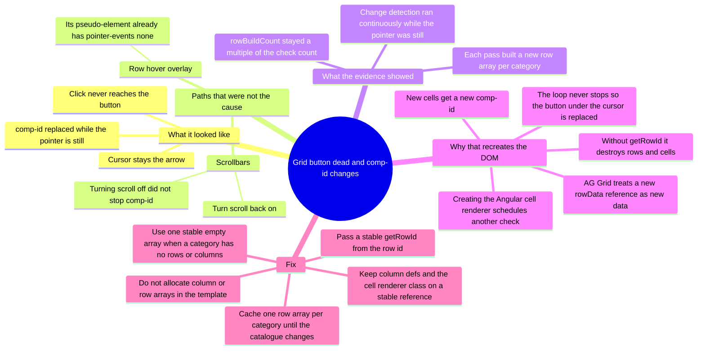

# AG Grid click

## Problem

Edit and Delete inside an AG Grid cell did not receive clicks, and the pointer cursor never appeared on them. In the element inspector, `comp-id` on the row and cell kept changing. Buttons outside the grid, using the same button classes, worked.

## Problem-solving mind-map

## Apply this

- Do not call a method from the template that returns a fresh `rowData` or `columnDefs` array on every check.
- Set `[getRowId]` to a stable function that returns the same id for the same row.
- Do not update parent state from `onRowDataUpdated`, `onModelUpdated`, `onGridSizeChanged`, or a cell renderer.
- Do not call `redrawRows()` or `refreshHeader()` on a timer or from those events.
- Define the cell renderer class and `cellRendererParams` once on the cached column definition, not inline in the template.
